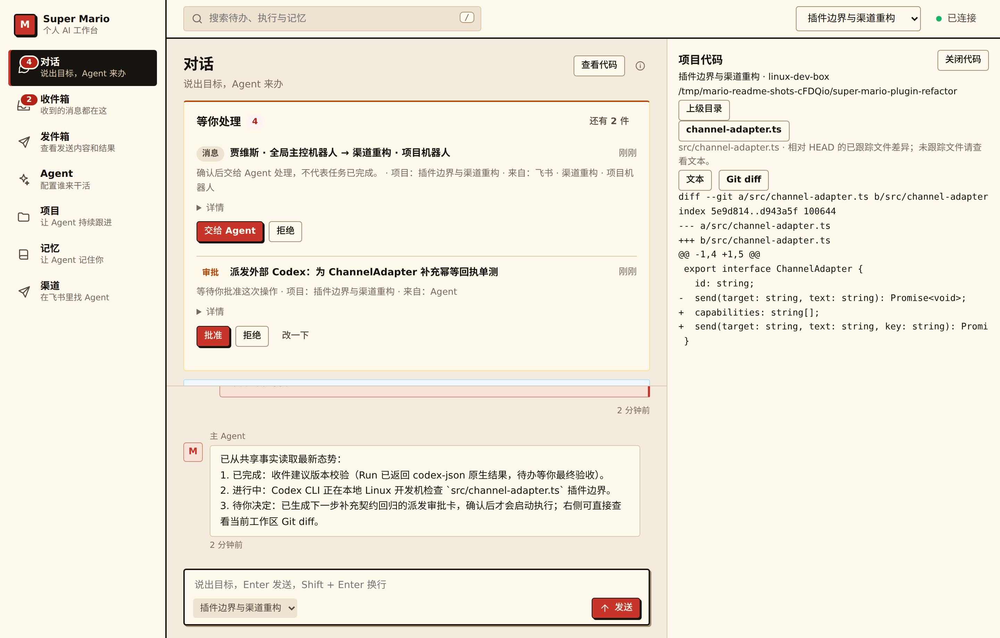
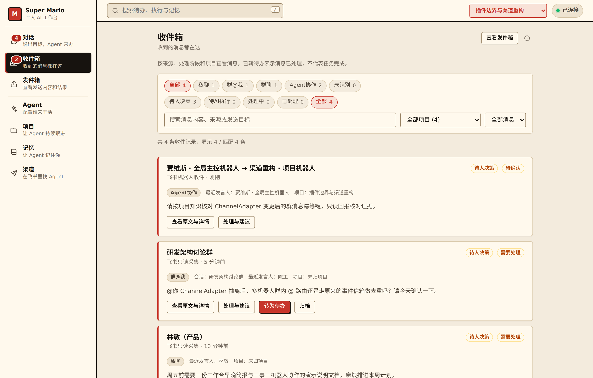
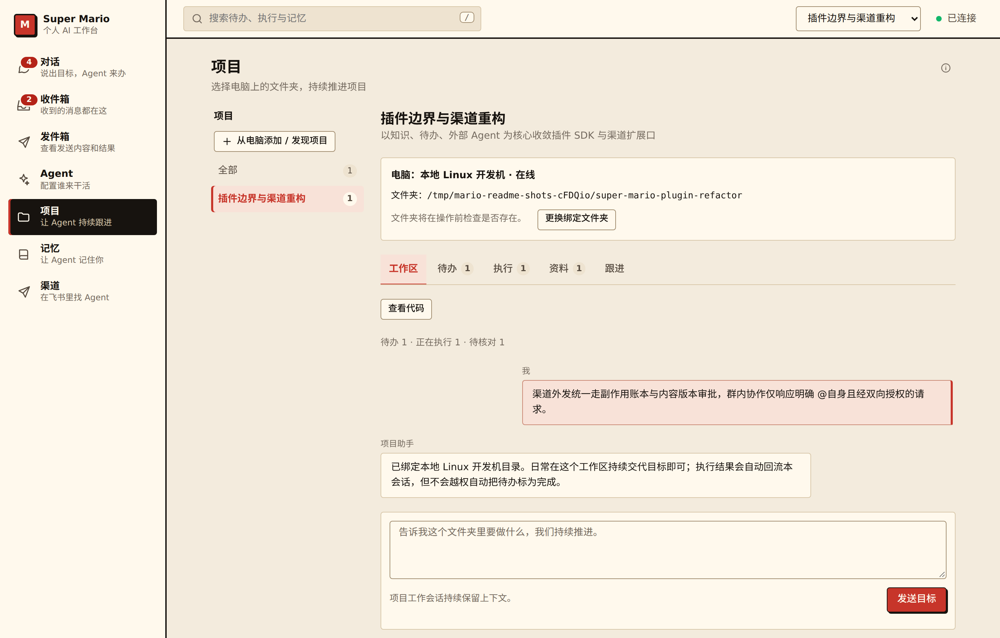
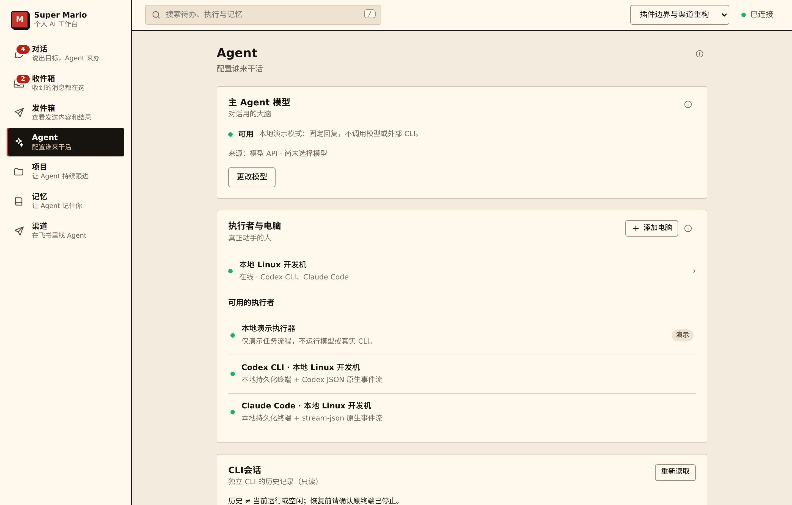
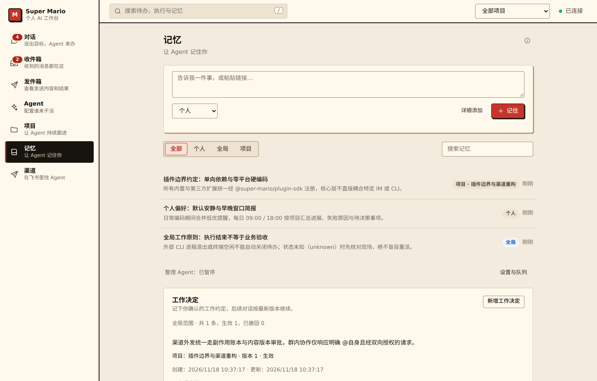
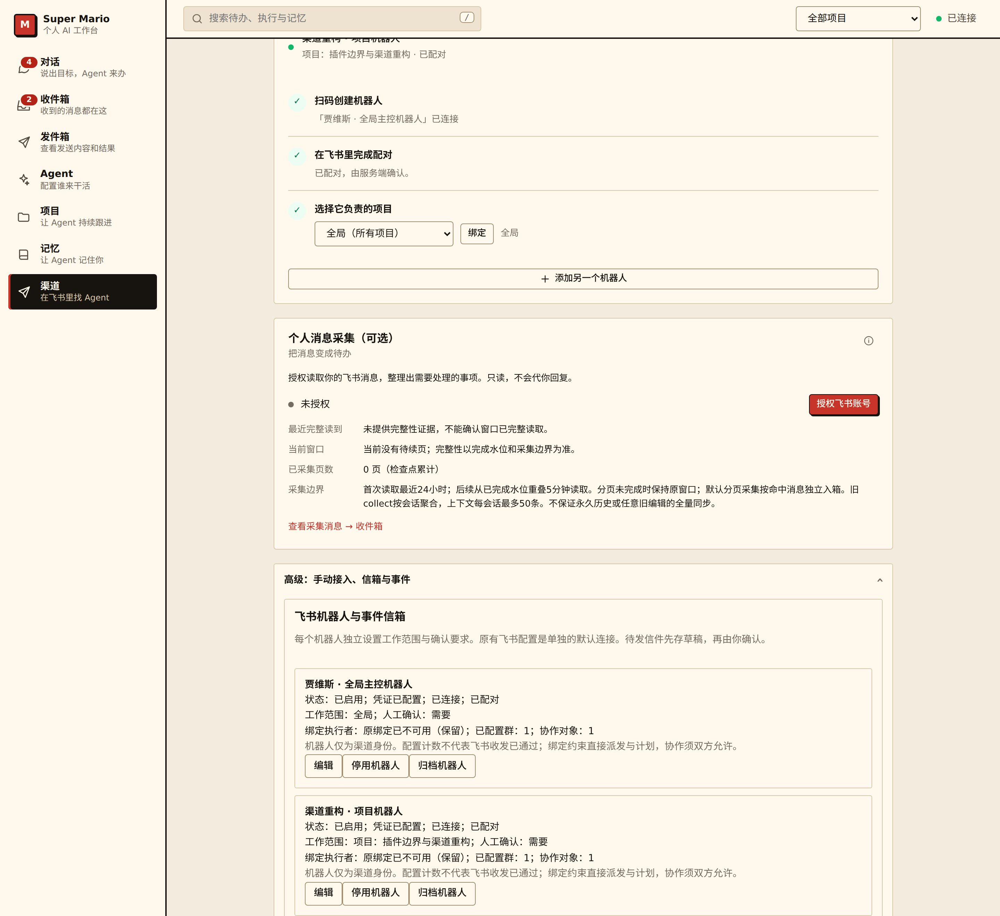

# Super Mario

面向 Linux 的本地优先、插件化个人 AI 工作台。单进程启动服务端与同源 Web，基于本地 SQLite 与 Markdown 文件持久化；需要跨机器运行外部 CLI 时通过轻量执行机代理连接。

```bash
npm install
npm start -- --demo
```

默认监听 `http://127.0.0.1:3000`（数据目录 `~/.super-mario/`）。`--demo` 演示模式无需模型 API Key、飞书账号或外部执行机即可完整体验产品流程，页面明确标注演示状态，不冒充真实模型或外部命令执行。

---

## 设计参考（Inspiration & References）

Super Mario 的产品体验与底层选型吸收了以下项目的优秀设计，并在自身架构约束下独立实现（不做一比一克隆）：

- **个人 AI 助手工作流与能力场景参考 [nwverse/persona](https://github.com/nwverse/persona)**：参考其围绕个人助手的主对话长期上下文、跨入口全局工作态势快照、绑定真实目录的项目持续工作区、统一收件箱人/AI 分流与四类建议确认、督办验收与返工、早晚/时间窗工作简报、多机器人范围信箱及群内协作等核心体验。
- **Agent 会话运行时底座**：封装 `@earendil-works/pi-coding-agent`（`pi` SDK），仅在 `packages/core/src/agent-runtime/` 内部桥接会话、串行输入队列与自定义工具循环。
- **远程终端观察与控制宿主**：执行机侧对接 `Herdr` 终端运行时协议，支持持久 PTY 全量/增量画面同步、断线重连与显式接管。

---

## 我们的核心主张（Core Principles）

与全栈大一统或重型微服务方案不同，Super Mario 坚持以下 5 条架构与工程主张：

1. **业务模型收敛为三大核心实体**
   只围绕 **知识（个人 / 全局 / 项目三层，其中全局代表通用工作原则而非公开）**、**待办（Todo）**、**外部 Agent（Executor + Run）** 组织核心业务真相。项目是绑定具体电脑与真实目录的持久工作区；飞书机器人是外部 Agent 的可选渠道身份，不另造竞争性的任务或 Agent 实体。
2. **单一插件体系 + 模块化单体**
   对外只维护一套工作台插件接口（`@super-mario/plugin-sdk`），屏蔽底层 `pi` 扩展机制；内置能力与第三方自定义插件（`<dataDir>/extensions/`）遵循同一清单、权限与 AST 导入边界检查。采用单进程服务端 + 无前端构建框架的原生 ES Module Web + 本地 SQLite + Markdown，不引入微服务、Redis、消息队列或外部数据库。
3. **接收、送达、执行、业务验收严格四分离**
   所有对外部世界产生影响的操作（派发任务、终端输入、渠道发信、定时派活）统一经过**内容版本审批**与**副作用账本（`Effects` / `Outbox`）**。外部 CLI 退出码为 0 或终端空闲绝不自动将待办标为完成；网络超时或服务重启导致结果不确定时一律记为 `unknown`，人工核实前绝不盲目自动重派或重发。
4. **本地优先 + 分机独立代理（零 SSH 侵入）**
   服务端不通过 SSH 远程登录执行机，而是由安装在目标机器上的 `super-mario-agent` 主动通过 WebSocket 连入服务端，贴近本机 Codex / Claude Code 原生事件流（`codex-json` / `claude-stream-json`）、CLI 历史索引与 Git 工作树运行。绑定电脑离线时保留现场与历史，绝不静默漂移到其他电脑执行。
5. **默认安静、少打扰与受控多机器人协作**
   Agent 提问与审批按“常设规则 → 独立只读督办会话 → 主 Agent → 用户”的可配置梯级流转，并结合 Web 多标签在场租约决定离场投递与窗口简报。子 Agent 可选绑定独立飞书机器人实现“一事一机器人”；群内仅响应明确 `@自身` 与授权成员，Agent 间协作（A2A）走内部持久事件信箱、双向范围授权与因果链去重，不依赖 IM 平台转发机器人间消息，无机器人配置也可完整运行。

---

## 真实界面预览（Screenshots）

> 以下截图均由本地真实启动的 `super-mario` 服务端、`super-mario-agent` 执行机代理、SQLite 存储与 Chromium 浏览器在隔离示例数据下实机渲染生成（不含私人聊天记录或真实密钥）。

### 1. 主对话、待你处理审批与实时代码侧栏
主对话自动注入跨项目共享工作态势，顶部集中展示待确认的跨机器人协作与派发审批；右侧代码侧栏通过执行机只读浏览项目目录与相对 `HEAD` 的 Git diff。



### 2. 统一收件箱与人 / AI 分流
汇总飞书只读采集与机器人信箱消息，支持按**私聊、群@我、群聊、Agent 协作**及处理阶段组合筛选；支持单条独立讨论、编辑四类建议（待办 / 派发 / 回复 / 结论）并绑定当前版本提交审批。



### 3. 项目持续工作区
每个项目绑定一台执行机上的真实目录（自动发现 Codex / Claude 历史目录并过滤临时目录与 linked worktree），在同一工作区内沉淀持续对话、待办、执行记录、项目记忆与独立跟进策略。



### 4. 外部 Agent、执行机诊断与自动跟进简报
统一管理主 Agent 模型（API 或本机 Codex CLI）、在线执行机、Codex / Claude Code / Pi CLI 执行器、原生 CLI 历史会话恢复审批，以及保守 / 平衡 / 少打扰三种策略预设与早晚/间隔窗口简报。



### 5. 三层记忆（个人 / 全局 / 项目）与跨入口工作决定
Markdown 文件为事实源并自动维护本地 Git 记录，支持独立常驻 CLI 整理受保护文档及 PDF 文字层 / DOCX 附件；底部维护带版本校验与撤回审计的跨入口工作决定账本。



### 6. 飞书渠道、多机器人信箱与一事一机器人协作
支持扫码三步接入、独立开关的个人消息三路分页只读采集，以及绑定全局 / 项目 / 事项范围与特定执行器的多机器人配置和群内受控 A2A 协作。



---

## 总体分层与目录结构

```text
┌──────────────────────────── Web（apps/web，原生 ES Module）───────────────┐
│ 对话 · 收件箱 · 发件箱 · Agent · 项目工作区 · 三层记忆 · 渠道与多机器人   │
└────────────────────────────────────┬──────────────────────────────────────┘
                                     │ 同源 HTTP REST + WebSocket
┌────────────────────────────────────┴──────── 服务端核心（packages/core）──┐
│ 网关/在场租约 │ 工作编排/计划 │ 交互卡/策略 │ 督办/窗口简报 │ 收件箱/待办 │
│ 副作用账本(Effects) │ SQLite 领域存储 + 持久事件箱/调度/发件箱 │ 机器连接 │
│ 主 Agent / 项目 / 督办运行时（唯一封装 pi SDK） │ 插件宿主（PluginHost）  │
└──────────────┬─────────────────────────────────────────┬──────────────────┘
               │ 统一扩展接口（packages/plugin-sdk）     │ WebSocket（代理主动连入）
      ┌────────┴────────────────────────┐       ┌────────┴──────────────────┐
      │ 默认与自定义插件（plugins/）    │       │ 执行机代理（agent-node）  │
      │ 飞书 · Codex · Claude · 知识库  │       │ 目录/历史发现 · 代码只读  │
      │ 收件分拣 · 每日简报 · 附件解析  │       │ Herdr 终端 · 常驻整理 CLI │
      └─────────────────────────────────┘       └───────────────────────────┘
```

| 路径 | 职责说明 |
| --- | --- |
| `bin/super-mario.js` / `bin/super-mario-agent.js` | 服务端与独立执行机代理命令行入口 |
| `packages/protocol/` | 前后端、渠道与执行机共享的序列化协议类型 |
| `packages/plugin-sdk/` | 唯一插件开发接口（工具、执行器、知识后端、钩子、服务、后台事件与权限） |
| `packages/core/` | 核心状态机、SQLite 事务存储、审批/副作用账本、工作态势快照与 `pi` 运行时封装 |
| `plugins/` | 9 个默认系统插件、PDF/DOCX 解析 worker 及可选 `command-inbox` 采集插件 |
| `apps/server/` | 同源 HTTP API、静态资源服务、WebSocket 推送与飞书连接器宿主接线 |
| `apps/agent-node/` | 执行机 WebSocket 客户端、心跳重连、制品 SHA256 确认加载与本机 RPC |
| `apps/web/` | 无构建框架的原生浏览器模块化前端（`lib/`、`ui/`、`features/`、`pages/`、`css/`） |

---

## 快速使用与本地开发

环境要求：**Linux**，**Node.js >= 24.9.0**。

### 启动真实主 Agent 与执行机

```bash
# 方式 A：复用本机已登录的 Codex CLI 作为主 Agent 模型提供者
npm start -- --provider codex-cli --model default --token '你的访问令牌'

# 方式 B：使用云端模型 API
export ANTHROPIC_API_KEY='你的密钥'
npm start -- --provider anthropic --model '<可用模型ID>' --token '你的访问令牌'

# 在本机或另一台 Linux 机器启动执行机代理（需预装已登录的 codex / claude 及 herdr）
SUPER_MARIO_TOKEN='同一访问令牌' node bin/super-mario-agent.js \
  --url http://127.0.0.1:3000 --name '我的 Linux 执行机'
```

### 开发与验证命令

```bash
npm run dev -- --demo       # 源码监听开发模式
npm run typecheck           # TypeScript 类型检查
npm run lint:plugins        # 系统与第三方插件统一 AST 导入边界检查
npm test                    # 单元、SQLite、HTTP/WS 与真实 pi SDK 集成测试
npm run test:web            # Playwright Chromium 端到端界面流程测试
npm run build               # 编译构建产物并同步 Web 静态资源
node scripts/verify-package.mjs # 临时目录打包安装与 CLI 启动冒烟验证
```

---

## 项目文档

- [主线功能矩阵](docs/feature-inventory.md)：G01–G24 核心场景映射、实现入口与验收状态。
- [项目验收报告](docs/acceptance-report.md)：分阶段自动化结果、真实 CLI 验证证据与待外部环境验收边界。
- [技术架构方案](docs/architecture.md)：核心职责、插件接口、`pi` 封装边界与状态机定义。
- [操作手册](docs/operations.md)：部署参数、模型与飞书配置、知识整理、多机器人协作与排错指南。
- [代码地图](docs/code-map.md)：各功能模块对应的精确源码与测试文件索引。
- [开发约定](AGENTS.md)：工程原则、模块边界与测试规范。
